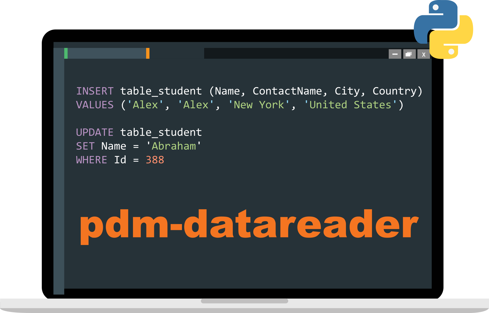

# PDM Reader

<p align="center">

</p>

[](https://img.shields.io/badge/Windows-0078D6?style=for-the-badge&logo=windows&logoColor=white)
[](https://img.shields.io/badge/mac%20os-000000?style=for-the-badge&logo=apple&logoColor=white)
[](https://img.shields.io/badge/Red%20Hat-EE0000?style=for-the-badge&logo=redhat&logoColor=white)
[](https://scm-compliance-api.radix.equinor.com/repos/equinor/neqsim/badge)


`pdm-datareader` is a python package for reading [Production Data Mart](https://wiki.equinor.com/wiki/index.php/Production_Data_Mart) (PDM) data into pandas DataFrames. It can read data in two ways:

- **Through the PDM API** (recommended for new users) — read one PDM view at a time with filters, column selection and sorting. No ODBC driver or Equinor network connection needed. See [API usage](#api-usage).
- **With SQL directly against the PDM database** — full SQL, but requires the ODBC driver and the Equinor network. Will be deprecated in a future release. See [SQL usage](#sql-usage).

Both handle authentication for end users with user impersonation (sign-in with your Equinor account), and both return only the data your PDM field access allows.

Pull requests, feature requests and issues are welcomed using the [GitHub Project Repository](https://github.com/equinor/pdm-datareader) or as a ServiceNow ticket directed to Production Data Mart.

## Install
1. Install the latest version of the python package using:  
    ```pip install pdm-datareader```
2. Linux users must apply for [Linux compliant device exclusion](https://accessit.equinor.com/Search/Search?term=linux+exclusion) to get multifactor authentication to work.

Only needed for [SQL usage](#sql-usage):

3. Ensure that [ODBC Driver for SQL Server](https://learn.microsoft.com/en-us/sql/connect/odbc/download-odbc-driver-for-sql-server) is installed. Currently supports both v18 and v17.  
This driver is bundled with the [Microsoft SQL Client](https://accessit.equinor.com/Search/Search?term=MICROSOFT+SQL+CLIENT) package in AccessIT, and should be pre installed on linux environments. Instructions for installing on MacOS can be found [here.](https://learn.microsoft.com/en-us/sql/connect/odbc/download-odbc-driver-for-sql-server).
4. MacOS users must install unixodbc. See [https://pypi.org/project/pyodbc/](https://pypi.org/project/pyodbc/) for current instructions.

## API usage
Available from version 2.6.0. The API reads one PDM view at a time and returns it as a pandas DataFrame.

### 1. Access
All requests to the PDM API go through a gateway that requires a **subscription key** in addition to your Equinor sign-in. You don't need to handle the key yourself: `pdm-datareader` reads it from Azure Key Vault automatically, using your own sign-in, and keeps it in memory only.

Your account needs:
- **PDM data access** — the same field-based roles as for the database, applied for in AccessIT.
- **Read access to the PDM API subscription key in Key Vault.** If you get a `SubscriptionKeyError` saying you have no access, contact the Production Data Mart team (e.g. a ServiceNow ticket directed to Production Data Mart).

#### Using your own subscription key (optional)
If you have your own subscription key, for example from the [Equinor API portal](https://api.equinor.com/product) ("Enterprise" type), it is used instead of the one in Key Vault. Treat it like a password: don't put it in notebooks, scripts or git repositories. Set it as an environment variable:

```powershell
# Windows (PowerShell), for the current user permanently
[Environment]::SetEnvironmentVariable("PDM_APIM_SUBSCRIPTION_KEY", "<your key>", "User")
```

```bash
# macOS / Linux, e.g. in ~/.bashrc or ~/.zshrc
export PDM_APIM_SUBSCRIPTION_KEY="<your key>"
```

Restart your terminal or IDE afterwards. Alternatively, set it in code from a source of your own with `set_subscription_key(...)`.

### 2. Check the connection
```python
import pdm_datareader as pdm

pdm.ping()          # e.g. {'version': '3.0', 'databaseCheckPassed': True}
```

The first call opens a browser window to sign in with your Equinor account; the same sign-in is used to read the subscription key from Key Vault. Later calls reuse the sign-in silently. If you have several Equinor accounts, choose one with `pdm.get_api_token(username="abcd")` (short name or full email address) before your first call.

### 3. Read data
```python
import datetime as dt
from pdm_datareader import read_api_view, Range

df = read_api_view(
    "WellProdDay",
    filters={
        "COUNTRY": "NO",
        "PROD_DAY": Range(dt.date(2024, 1, 1), dt.date(2024, 1, 31)),
    },
    columns=["PROD_DAY", "WELL_UWI", "ALLOC_OIL_VOL_SM3"],
    order_by="PROD_DAY DESC, WELL_UWI",
)
print(df)
```

- The first argument is the **view name in the API**, e.g. `WellProdDay` (the SQL view `PDMVW.WELL_PROD_DAY`). Views and their columns are described on the [PDM documentation site](https://pdm-docs.app.radix.equinor.com/user_documentation/views/well_prod_day/).
- **All matching rows are returned** by default, just like a SQL query without `TOP`. For large views, always use filters and `columns` to limit the result.
- Date-time columns are returned as `datetime64`.

### Arguments

| Argument | Description | Example |
|---|---|---|
| `filters` | Column name → filter. See [Filters](#filters). | `{"COUNTRY": "NO"}` |
| `columns` | Columns to return. Default: all columns. | `["PROD_DAY", "WELL_UWI"]` |
| `order_by` | Sort order, one or more columns, `ASC`/`DESC`. Default: the view's default order. | `"PROD_DAY DESC, WELL_UWI"` |
| `top` | Maximum number of rows. Default: all rows. Combined with `order_by`, sorting happens first. | `top=10` |
| `skip` | Number of rows to skip, for paging yourself. See [Paging](#paging). | `skip=1000` |
| `timeout` | Seconds to wait for a response. Default: 300. | `timeout=600` |
| `verbose` | Print progress messages. | `verbose=True` |

### Filters
All filters in `filters` must match (AND). A filter value can be:

| Filter | Matches | Example |
|---|---|---|
| A single value | Equal to the value | `{"COUNTRY": "NO"}` |
| A list | Any of the values | `{"WELL_UWI": ["NO 15/9-F-12", "NO 15/9-F-14"]}` |
| `Range(a, b)` | Between `a` and `b`, **both included**. Leave out one end for an open range: `Range(a)` or `Range(end=b)`. Numbers and dates. | `{"PROD_DAY": Range(dt.date(2024, 1, 1), dt.date(2024, 1, 31))}` |
| `Like(text)` | Contains `text` | `{"WELL_NAME": Like("F-1")}` |
| `StartsLike(text)` | Starts with `text` | `{"FIELD_NAME": StartsLike("JOHAN")}` |
| `EndsLike(text)` | Ends with `text` | `{"FIELD_NAME": EndsLike("SVERDRUP")}` |
| `IsNull()` | Empty (null) | `{"COMMENTS": IsNull()}` |
| `In([...])` | Any of the values or filters | `{"EVENT_ID": In([Range(2, 5), 7])}` |
| `Raw(expression)` | Sent to the API as written (advanced) | `{"EVENT_ID": Raw("RANGE(2 \| 5)")}` |

All helpers are imported from `pdm_datareader`, e.g. `from pdm_datareader import Range, Like, IsNull`.

Filter values cannot contain the characters `| , [ ] ( ) "`, because the API has no way to escape them; you'll get a `ValueError` before anything is sent. Use `Like`/`StartsLike`/`EndsLike` on a part of the value without those characters instead.

### Paging
`read_api_view` fetches all rows in one request. If you want to fetch a large result in pages yourself, combine `top`, `skip` and an `order_by` on columns that **together uniquely identify each row**. Without a unique order, rows can be repeated or missed between pages.

```python
page_size, skip, pages = 50_000, 0, []
while True:
    page = read_api_view("WellProdDay", filters={...}, order_by="PROD_DAY, WELL_UWI",
                     top=page_size, skip=skip)
    pages.append(page)
    if len(page) < page_size:
        break
    skip += page_size
```

Often it's simpler to split a large request by date instead, e.g. one `read_api_view` call per month with a `Range` filter.

### Moving from SQL to the API

| SQL | `read_api_view` |
|---|---|
| `FROM PDMVW.WELL_PROD_DAY` | `read_api_view("WellProdDay", ...)` |
| `SELECT A, B` | `columns=["A", "B"]` |
| `WHERE A = 'x' AND B = 1` | `filters={"A": "x", "B": 1}` |
| `WHERE A IN ('x', 'y')` | `filters={"A": ["x", "y"]}` |
| `WHERE D BETWEEN '2024-01-01' AND '2024-01-31'` | `filters={"D": Range(dt.date(2024, 1, 1), dt.date(2024, 1, 31))}` |
| `WHERE A LIKE '%x%'` / `'x%'` / `'%x'` | `Like("x")` / `StartsLike("x")` / `EndsLike("x")` |
| `WHERE A IS NULL` | `filters={"A": IsNull()}` |
| `ORDER BY D DESC, A` | `order_by="D DESC, A"` |
| `SELECT TOP(10)` | `top=10` |

Joins, `GROUP BY`/aggregates, `OR` between different columns and calculated columns are not available in the API. Read each view with `read_api_view` and combine or aggregate the DataFrames with pandas, or keep using [SQL](#sql-usage) for those queries for now.

### Troubleshooting

| Error | Meaning |
|---|---|
| `SubscriptionKeyError` | The subscription key couldn't be read from Key Vault (e.g. no access) or was rejected by the gateway. The message says which. If you set `PDM_APIM_SUBSCRIPTION_KEY` yourself, check that the key is correct. |
| `PdmAuthError` | Sign-in failed or access was denied. |
| `PdmTimeoutError` | The request took too long. Narrow the filters, request fewer `columns`, or split the request (e.g. by date). |
| `PdmApiError` | Other errors from the API. The message includes a `TraceId` when available; include it when reporting issues. |
| Empty result | You may not have access to the field. `pdm.user_access()` lists the fields and facilities you have access to. |

## SQL usage
> **Note:** Querying the PDM database directly with SQL will be deprecated in a future release. New code should use the [API](#api-usage) where possible.

Requires the ODBC driver (see [Install](#install)) and a connection to the Equinor network.

See [examples/demo.py](examples/demo.py) or try the code below that queries PDM and retrieves data:  

``` python
import datetime as dt
from pdm_datareader import query

# Example with parameter bindings to avoid SQL injection issues (recommended)
sql = '''
SELECT top(100) * 
FROM PDMVW.WELL_PROD_DAY 
WHERE COUNTRY = :countrycode 
AND PROD_DAY = :startdate
'''
df = query(sql, params={'countrycode': 'NO',
                 'startdate': dt.datetime(2022, 1, 1)})
print(df)

# Example without parameters (not recommended)
sql = 'SELECT TOP(1) * FROM PDMVW.WELL_PROD_DAY'
df = query(sql)
print(df)
```
